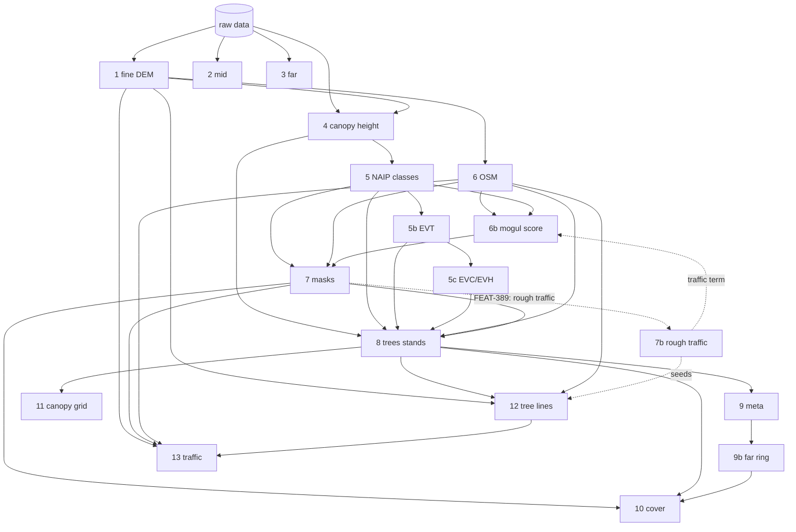
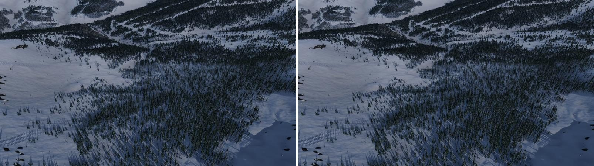
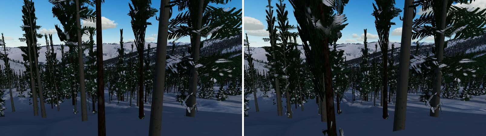
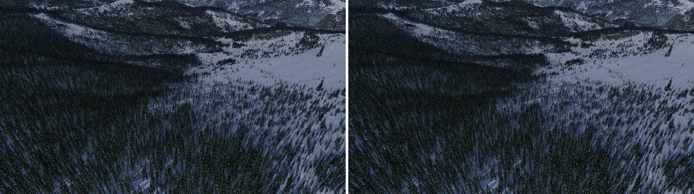
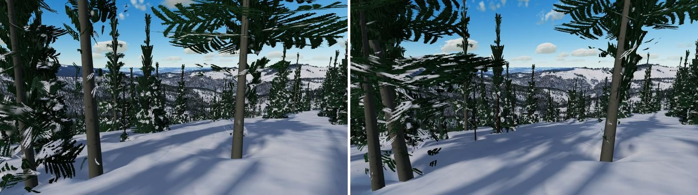
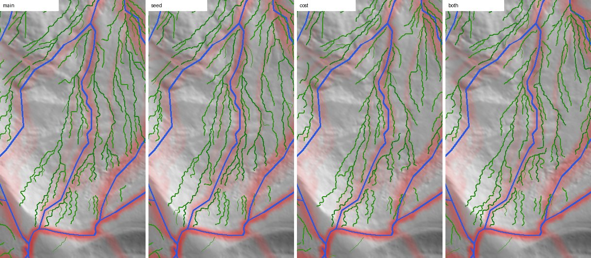
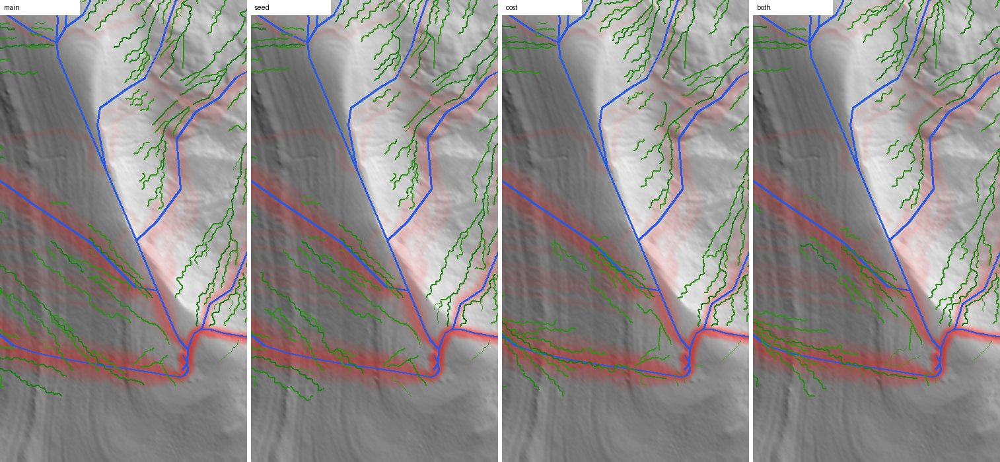

# Build order: traffic earlier, without regressing the trees (FEAT-389)

Research and test card (#255). The question: the traffic map (FEAT-379) is the last stage of `build_pack.py`. Could
it run earlier, so that where riders go drives the tree lines and the moguls, and does that need a reorder or a split
of `build_pack.py`? Measured on Vail on 2026-11-25, from the raw data in `C:\Users\Drew\Documents\snowboard-sim\raw\vail`,
against a build of `main` (c72be69) on the same data. The prototype is on the branch `issue-255-build-order-proto`
(not for merging).

**Short answer: keep the order. Add one stage, a rough traffic pass at the end of stage 7, and pass its density to
the moguls (stage 6b's score, painted in 7) and to the tree line seeds (stage 12).** It is about 6 s on Vail, it
reads only files already on disk at that point. With nothing reading it, the whole pack (trees, stands, cover, canopy,
far trees, tree lines, traffic) came out byte for byte the same as `main`; with the moguls and the tree line seeds
reading it, only the moguls, the mogul scores, the tree lines and the traffic changed. Traffic needs no reorder; the split of `build_pack.py` into stage modules is planned in Q5
for its own sake (readability, and cheap reorders later).

## Q1. Data flow today

`build_pack.py` stages 1 to 9 are one script sharing in-memory grids; 9b to 13 are modules that read the pack folder
back from disk (plus the raw folder for 9b and 10). The table lists what each stage really reads (the in-memory names
from a def-use pass over the script's sections, the files from the modules), and what it writes.

| stage | reads | writes (pack) | in memory, for later stages |
|---|---|---|---|
| 1 fine DEM | raw `dem1m/` (+ relocate sources) | `fine/`, `coarse/` | `dem` (1 m, freed after 6b) |
| 2 mid | raw `dem10m/` | `mid/` | |
| 3 far | raw `mapterhorn/` | `far/` | |
| 4 canopy height | raw `ept/*.laz` (Silver: `landcover/` ETH), `dem` | | `chm`, `dem2`, `has_pts`, 2 m grid |
| 5 NAIP classes | raw `naip1m/`, `chm`, `dem2` | `debug/` | `canopy`, `canopy_grown`, `ndvi2`, `rock*`, `scree_w`, `slope2`, `gx`/`gy`, `treeline_m` |
| 5b LANDFIRE EVT | raw `landfire/`, `canopy`, NAIP bands | | `evt2`, `lf_forest2`/`lf_open2`, `aspen_like`, `lodgepole_like` |
| 5c EVC / EVH | raw `landfire/` | | `lf_height` and cover |
| 6 OSM | raw `osm/`, `grooming/`, `names/`, `dem` | | `runs`, `lifts`, `buildings`, `roads`, `water`, `peaks`, `labels`, `streams` |
| 6b mogul score | `runs`, lift stations (tops within 150 m), `slope2`, `gx`/`gy`, grooming nights | `features.json` | `runs[].mogulScore` |
| 7 masks | `runs`, `canopy`, `canopy_grown`, rock / scree, `roads`, `buildings`, `dem2`, `slope2` | `mask/`, `dir/`, `ao/`, `moguls/` | `groomed`, `built_any` |
| 8 trees, shrubs, rocks | `chm`, `ndvi2`, `canopy`, `groomed`, `built_any`, rock, `lifts` (towers), LANDFIRE, `streams`, `dem2` | `trees/`, `stands/`, `shrubs/`, `rocks/` | |
| 9 meta | every stage's entry | `meta.json` | |
| 9b far tree ring | raw `ept/` + `ept_far/`, `meta.json` | `farTrees/` | |
| 10 cover | raw `landcover/`, `mask/` (A), `trees/`, `stands/`, `farTrees/` | `cover/` | |
| 11 canopy grid | `trees/`, `stands/` | `canopy.png` | |
| 12 tree lines | `fine/`, `trees/`, `runs` | `treeLines.json` | |
| 13 traffic | `coarse/`, `mask/` (B groomed, A canopy), `runs`, `lifts`, `treeLines.json` | `traffic/` | |



The dotted edges are the proposal. Stage 6b's score is computed in 6 and painted in 7; with the rough pass it is
scored again in 7, after the mask is written and before the mogul field is painted.

**Next to each other only by position in the file:**
- 11 canopy grid after 10 cover: neither reads the other.
- 12 tree lines after 9b, 10 and 11: it reads the fine heights, the trunks and the runs, so it could run right after
  stage 9. Its docstring says "after the canopy grid", but nothing in it reads `canopy.png`.
- 2 mid and 3 far read only the raw data and the setup; they could run anywhere.
- 6b sits between OSM and the masks but only needs `slope2` and the runs; its field is painted in 7.

**Derived twice (or three times):**
- "Where the riders are": `moguls.py`'s lift-top term (a run starting within 150 m of a lift station scores 1.0
  against 0.8) and `traffic.py`'s release (runs starting within `LIFT_RUNS`, 150 m, of a lift top share its
  riders by capacity). The traffic map is the fuller version of the same idea.
- Cat tracks: `moguls.NO_MOGUL_NAME` by name (road, catwalk, traverse ...), `traffic.py` by geometry (a line that
  drops less than `TRACK_K` of the ground's slope across it). They disagree on unnamed tracks.
- Run widths: `canopy_spots.run_half_width` is shared by the masks, the moguls and traffic's fallback, but
  `tree_lines.RUN_KEEP` has its own half-width per difficulty for its walls.
- The fall line: stage 5 (`gx`/`gy` on the 2 m grid), `tree_lines.py` (fine heights, 3 m blur) and `traffic.py`
  (coarse heights, 8 m blur). Different scales on purpose; not worth sharing.
- The trunks: `cover.py`, `canopy.py` and `tree_lines.py` each read `trees/*.bin` back (`cover.tree_records`), and
  `cover.py` calls `stands.expected_crowns` twice. A few seconds each on Vail.

**Written and never read:**
- In the pipeline itself (the game reads them): `ao/`, `dir/`, `moguls/`, `shrubs/`, `rocks/`, `canopy.png`,
  `traffic/`, `mid/`, `far/`. `debug/` is read by nobody (a human aid).
- Dead in `build_pack.py`: `piste_polys` (stage 6, made empty and never filled) and `snowfield` (stage 5, computed
  then deleted unread).

## Q2. Could traffic run before the trees?

Yes, and earlier than that. Traffic reads four things: the coarse heights (written in stage 1), the mask's groomed
and canopy channels (written in stage 7), the runs and lifts (stage 6) and `treeLines.json` (stage 12). Everything
but the tree lines is on disk once stage 7 has written `mask/`. The only part of `meta` it needs is `bounds`,
`terrain` and `mask`, which exist as `coarse_meta` and `mask_meta` then. So the prototype runs `traffic.density()`
(the simulation with no tree lines, nothing written) right after `write_mask_set` in stage 7.

The open / canopy boundary it needs is the mask's A channel (`canopy_cover`), the same one the final pass reads: no
tree placement is needed for it. The tree lines are both an input and a candidate consumer, so the order is a
**two-pass**: rough traffic (terrain, runs, lifts, mask) at 7, tree lines at 12 reading it, final traffic at 13
reading the tree lines, as today. Making the tree lines the only input of traffic, or traffic the only input of the
tree lines, does not work, for a reason the prototype showed (Q3): the rough traffic has almost nothing inside the
trees.

Measured on Vail: the rough pass takes 6.0 s (10,040 riders, 12.3 % of the cells ridden against 16.1 % with the
tree lines). With no tree lines, 18 % of the density lies on cells whose canopy cover is over 0.35, nearly all of it
on the run edges; the final map has 27 % there, the difference being the tree lines' own deposit.

## Q3. Tree lines from the traffic

Today a tree line starts at seeds placed evenly along a run's upper 85 % (one every 45 m, 28 m beside a tree run),
both sides, then rides a cost field over the trunks and terrain to the run's foot. Two ways to feed the rough
traffic in, both in the prototype (`SBA_TL_TRAFFIC`):

- **seed**: a seed candidate is kept with a chance from how busy its side of the run is (the rough density's maximum
  0 to 18 m off the centreline, over the run's busiest; 0.15 at none). Riders duck into the trees where riders are.
- **cost**: a move costs less where the rough density is high (`1 / (1 + 1.5 density)`), so lines follow the traffic.

Whole-Vail results (standalone on `main`'s pack, `python pipeline/tree_lines.py`, 2 minutes each):

| | lines | km | squeezes / breaks at a trunk | trunks in a corridor | stall stretches | spacing median (in 3 to 10 m) | within 15 deg of the fall line, 25 to 35 deg pitch |
|---|---|---|---|---|---|---|---|
| main | 2,236 | 311.3 | 897 / 84 | 0 | 168 | 11.2 m (36 %) | 0.238 |
| seed | 2,157 | 301.4 | 979 / 105 | 0 | 164 | 11.2 m (35 %) | 0.235 |
| cost | 2,221 | 300.7 | 929 / 98 | 0 | 164 | 11.0 m (37 %) | 0.243 |
| both | 2,138 | 295.6 | 845 / 64 | 0 | 151 | 11.2 m (36 %) | 0.242 |

Per run, Steep and Deep: 29 lines on `main`, 30 seed, 26 cost; Champagne Glade 35 / 38 / 38; Riva Glade 21 / 17 / 18.

What it shows:
- **The rough traffic is blind inside the trees.** An off-piste rider in `traffic.py` spreads over the open width,
  which ends at the canopy (`CANOPY` 0.35), and only enters the trees along a tree line. So "lines laid along where
  simulated off-piste riders go" is circular: there is no off-piste traffic in the forest until the lines exist.
  The **cost** variant only moves lines near the run's edge, where the corridor already walls them off; in the trees
  it is the current rule.
- **What the traffic does know is where riders pass the trees**: the busy upper stretches below the lift exits and
  the cat track entries. The **seed** variant moves the seeds there; the quiet lower stretches of a long run get
  fewer, which on Steep and Deep reads as more lines dropping in from the top and the cat track, fewer starting
  half-way down. Plan views below, under the prototype.
- All variants keep every check that matters for the trees: no trunk in a corridor, the spacing band, the
  straightness figures within noise. None touches `trees/` (the lines never move a trunk; the game moves stems).
- The differences are small. Seeding by traffic is a defensible improvement, not a transformation; whether the
  lines "read more like real ridden lines" is Drew's call from the stills.

## Q4. Moguls from the traffic

`moguls.run_mogul_score` multiplies a run's score by a traffic term `t`: 1.0 if the run starts within 150 m of a
lift station, else 0.8. The prototype replaces that with the rough density along the run's centre line (75th
percentile, 0 to 1): `t = 0.8 + 0.2 smoothstep(0.3, 0.7, density)`, the same 0.8 to 1 range, the edges at the
scoring runs' density quartiles on Vail. So it changes what drives the term, not how much it can move a score.

On Vail the lift-top flag and the density agree only loosely (Spearman 0.30 over the 121 scoring runs; near-top
runs' median density 0.73, the rest 0.58). 48 of the 121 scores move by more than 0.05, the mean by 0.05; runs
scoring 0.3 or more go from 106 to 107. The biggest moves:

| run | difficulty | score main | with traffic | near a lift top | density |
|---|---|---|---|---|---|
| The Pump House | expert | 0.80 | 1.00 | no | 0.79 |
| Cady's Cafe | expert | 0.80 | 1.00 | no | 0.78 |
| The Preserve - Lower, Lover's Leap, Resolution, Hairbag Alley, Kangaroo Cornice | advanced | 0.72 | 0.90 | no | 0.68 to 0.76 |
| Steep And Deep | expert | 1.00 | 0.86 | yes | 0.45 |
| The Divide | advanced | 0.90 | 0.72 | yes | 0.19 |
| Inner Mongolia Bowl, Gorky Park, Bolshoi Ballroom | advanced | 0.63 | 0.50 | yes | 0.30 |

It is the better driver in kind: the lift-top flag rewards a run for starting near any station, however few riders
that lift carries (the Mongolia bowls drop), and misses a run that riders reach some other way, down a cat track or
another run (the advanced runs that rise). Two caveats. The traffic itself is a model: its riders split by `POPULAR` per difficulty and lift
capacity, not counts. And Steep and Deep dropping to 0.86 shows the off-piste spread (riders fanned over a wide open
width read as a low density): a term on the run's busiest stretch, or on the riders per metre of width, may suit
ungroomed runs better. A tuning card, not a reason to keep the flag.

## Q5. Split `build_pack.py` into stage modules

The split is worth doing for readability on its own; traffic does not need it (one call after the mask is written is
enough, Q2). The layout below is **provisional**: FEAT-390 (MapPacker #259, game #871) sets the rules and each repo's
package layout, and had no draft yet when this was written. Reconcile the names with it before FEAT-391 builds any of
this.

### What the split has to carry

- Stages 1 to 9 share in-memory grids on one 2 m frame: `dem2`, `chm`, `canopy`, `canopy_grown`, `ndvi2`, `slope2`,
  `rock_w`, `scree_w`, `groomed`, `built_any`, the LANDFIRE layers, `runs`, `lifts`, `streams` and the frame itself
  (`X0..Y1`, `OX`/`OY`, `R2`, `H2`/`W2`, `to_ll`). The manual `del`s keep the peak down (the 1 m `dem` is 540 MB and
  goes after 6b). A split must not raise the peak.
- 9b to 13 are already modules that read the pack back from disk and take `meta`; only their call sites move.
- Every random draw has its own seeded generator (`default_rng(3)` trees, `(20)` shrubs, `(11)` rocks; tree lines and
  traffic seed per run): moving code does not move a draw. Float results depend on the order of operations, so a
  move PR copies expressions as they are.

### Package layout (provisional)

```
pipeline/
  build_pack.py              orders the stages, nothing else (CLI unchanged: build_pack.py <slug> <raw> <out>)
  build/
    frame.py                 Frame: the pack box, origin, 2 m grid, CRS transforms; read from the config once
    stage.py                 Stage, Grids and the runner (below)
    terrain.py               1 fine + coarse, 2 mid, 3 far (raw heights -> height sets)
    canopy_height.py         4 (lidar or ETH -> chm, dem2)
    naip.py                  5 (NAIP or WorldCover classes -> canopy, rock, scree, slope)
    landfire.py              5b, 5c
    features.py              6 (OSM, grooming, names -> runs, lifts, ... features.json)
    masks.py                 7 (mask, dir, ao)
    moguls_stage.py          6b + the mogul field of 7, calling moguls.py
    trees.py                 8 trees and stands
    shrubs_rocks.py          8 shrubs and rocks
    meta.py                  9
    post.py                  9b to 13: thin wrappers round far_trees, cover, canopy, tree_lines, traffic
```

The existing domain modules (`moguls.py`, `stands.py`, `species.py`, `cover.py`, `tree_lines.py`, `traffic.py` ...)
stay where they are until FEAT-390 says where domain modules go; the stage modules call them.

### The stage interface

```python
@dataclass(frozen=True)
class Stage:
    name: str                      # "masks": the log prefix and the timing key
    reads: tuple[str, ...]         # grid names it needs from earlier stages
    writes: tuple[str, ...]        # grid names it adds
    files: tuple[str, ...]         # pack paths it writes ("mask/", "features.json"); for the record and the tests
    run: Callable[[Frame, Grids], dict]   # returns its meta entries ({"mask": {...}})
```

- `Grids` is a dict-like store. The runner checks each stage's `reads` are present before it starts and that it set
  its `writes`.
- **Freeing by declaration**: before the run, the runner works out the last stage that reads each grid and drops the
  grid right after that stage. This replaces the hand-written `del`s; the peak is the same or lower, and the test
  below catches a stage that reads something it did not declare (it is gone).
- **Logging and timing**: the runner prints `[  t s] <name>` as today and, at the end, one line per stage with its
  seconds and the pack bytes it wrote, kept in `meta.json` `build.stages` (`pack_report.py` and `build_resort.py` can
  read it). Inside a stage, `log()` stays as it is.
- **Order is data**: `build_pack.py` is a list of stages. A reorder is a list edit, and the runner refuses an order
  where a stage reads a grid no earlier stage writes. 9b to 13 declare files instead of grids (`trees/` before
  `cover/`), checked the same way.

### PRs in order (each a pure move, FEAT-391)

Each PR proves nothing changed the same way: a fresh Vail build and the synth pack, byte-compared per folder with
`main`'s (this card's `bytecmp` script, kept as `tools/pack_bytes.py`: everything identical but `meta.json`'s build
stamp), and the build time within the run-to-run noise (measure it: two `main` builds back to back first).

1. `build/frame.py`, `build/stage.py`, and 9b to 13 as stages in `build/post.py` (they are already modules: the
   smallest step, and it proves the runner, the timing line and the byte check). Stages 1 to 9 stay inline, run as one
   stage.
2. Stages 1 to 3 (`terrain.py`): raw heights only, no shared grids but `dem`.
3. Stage 6 (`features.py`) and 6b with the mogul field from 7 (`moguls_stage.py`).
4. Stage 7 (`masks.py`).
5. Stage 8 (`trees.py`, `shrubs_rocks.py`): the riskiest for the bytes; trees, stands, shrubs, rocks compared.
6. Stages 4 to 5c (`canopy_height.py`, `naip.py`, `landfire.py`).
7. Stage 9 (`meta.py`); `build_pack.py` is now the list.

Then the behaviour cards, each on its own: the rough traffic stage (a new entry in the list after `masks`), the
mogul term, the tree line seeds.

### Reorder

With the split, a reorder is cheap but there is little to gain: 11 before 10 and 12 before 9b change nothing but the
log. The one with a payoff is running independent post-stages side by side: 9b + 10 + 11 + 12 is about 300 s of the
587 s Vail build, and 12 (tree lines, 110 s) reads none of 9b, 10 or 11, so running it beside 9b would save about
100 s. Memory and the runner's freeing need checking first.

## The prototype and the trees

Three Vail builds from the same raw data and config, one after the other on Drew's PC (12 threads; no other build
running), each `python pipeline/build_pack.py vail <raw> <out>` into the worktree's own `packs/`:

| build | flags | wall time | rough pass | tree lines | traffic |
|---|---|---|---|---|---|
| `main` (c72be69) | none | 588 s (9 m 48 s) | | 110 s | 8 s |
| rough pass only (nothing reads it) | `SBA_ROUGH_TRAFFIC=1` | 617 s | 6.8 s | 118 s | 7 s |
| candidate | `SBA_ROUGH_TRAFFIC=1 SBA_MOGUL_TRAFFIC=1 SBA_TL_TRAFFIC=seed` | 621 s | 6.8 s | 124 s | 10 s |

The rough pass costs about 7 s. The rest of the 30 s is run-to-run noise: the rough-only build was already 11 s
behind `main` at the end of stage 1, before any changed code ran. Measure two `main` builds back to back before
reading a change under 30 s into these numbers.

Byte comparison, file by file per top-level folder (`sha` of every file):

| folder | rough pass only vs `main` | candidate vs `main` |
|---|---|---|
| `trees/` (144), `stands/` (144), `cover/` (4), `canopy.png`, `farTrees/` (363) | identical | identical |
| `shrubs/`, `rocks/`, `mask/`, `ao/`, `dir/`, `fine/`, `coarse/`, `mid/`, `far/`, `debug/` | identical | identical |
| `treeLines.json` | identical | changed (the seeds, the point) |
| `traffic/` (144) | identical | 68 tiles changed (follows the tree lines) |
| `moguls/` (144) | identical | 39 tiles changed (the traffic term, the point) |
| `features.json` | identical | changed (`mogulScore` only) |
| `meta.json` | `build` and `pipeline` stamps only | the stamps, the tree line and traffic summaries |

So running traffic at stage 7 is free of side effects, and the candidate changes exactly the three things it means
to. Two more checks:
- The candidate's `treeLines.json` is byte-identical to the `seed` variant run standalone on `main`'s finished pack:
  the rough pass at stage 7 sees the same files as a pass on the finished pack, and the tree lines are pure on the
  pack's files, so either place gives the same lines.
- The game's `tools/treelinecheck.mjs` on both packs: Steep and Deep keeps a median of 3 deep lines within 60 m
  (main 3), 2 lines drop in from the cat track (main 2), 0 trunks in a corridor. Both packs fail one check the same
  way: "the piles ease up, never a wall", steepest face 45 degrees on `main`, 47 on the candidate (FEAT-381's side
  hits; not this card's change, noted below).

### Stills

Shot with the game's `tools/compare.mjs` on the RTX 2070 SUPER (ANGLE D3D11), both sides the game's `main` (ce9bb75),
left `main`'s pack, right the candidate's (copied in with `npm run get -- --from`); cameras matched exactly. The
sliders are in the game worktree, `game/shots/compare/fe389-*/index.html`; reduced pairs here.

- Steep and Deep from 200 m (`--at 1650,-3900,14,-35,50,200`): no difference you can see from the air at this
  height; the lines are under the canopy.
  
- Steep and Deep in the trees (`--at 1660,-3820,20,-10,60,1.7`): the lines moved, and the game's generated stems moved
  with them (stems step out of a trench to its bank, FEAT-333), so the near trees differ although `trees/` and
  `stands/` are the same bytes.
  
- Champagne Glade from 200 m (`--at 1450,-4350,300,-35,50,200`) and in the trees (`--at 1150,-4010,300,-10,60,1.7`).
  
  

Plan views of the tree line variants (green, darker = stronger) over the hillshade, the rough traffic in red and the
runs in blue, left to right `main`, `seed`, `cost`, `both`:




## Recommended order

Keep stages 1 to 13 where they are and add:

1. **7b rough traffic**: `traffic.density()` right after `write_mask_set` in stage 7 (6 s on Vail), in memory.
2. **The mogul traffic term** from it, scored before the mogul field is painted in stage 7 (then `features.json`
   is written once, after it, instead of at the end of 6b).
3. **The tree line seeds** from it in stage 12.
4. Stage 13 unchanged: the final traffic with the tree lines.

The trees, stands, cover, canopy and far ring do not move: none of them reads the moguls, the tree lines or traffic.

## Follow-ups for Drew to pick from (none filed)

1. Rough traffic at 7b, feeding the tree line seeds (the prototype's `seed`), behind a check that the trees and
   cover stay byte-identical (this card's comparison as a test on the synth pack).
2. The mogul traffic term from the rough traffic in place of the lift-top flag, with a look at the ungroomed spread
   (Steep and Deep at 0.86).
3. The `build_pack.py` split, PR by PR as in Q5 (FEAT-391 builds it once FEAT-390's rules are agreed).
4. One cat-track rule shared by `moguls.py` and `traffic.py` (name and geometry).
5. Run stage 12 beside 9b / 10 / 11 (about 100 s off a Vail build), after the split and a memory check.
6. Delete `piste_polys` and `snowfield` from `build_pack.py`.
7. Fix `tree_lines.py`'s docstring ("after the canopy grid": it reads none of it).
8. A pack byte-compare tool (`tools/pack_bytes.py`, this card's script) for every pipeline PR that should not change
   the output, and two back-to-back `main` builds to know the build time noise.
9. Game repo: `treelinecheck.mjs` fails "the piles ease up, never a wall" on Vail as built from `main` today (steepest
   face 45 degrees; FEAT-381's side hits, #861). Not caused here; a bug card if Drew wants it.

Not covered here: gaps opening in stands near busy runs. That would change `stands/` and `cover/` on purpose, so it is
a look change for Drew to ask for first; the rough traffic at 7b would be there before stage 8 if he does.
